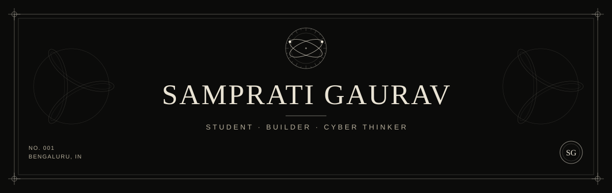

  
   
   
  <a href="https://samprati.dev"><strong>Portfolio ↗</strong></a>&nbsp;&nbsp; / &nbsp;&nbsp;<a href="https://www.linkedin.com/in/sampratigaurav/">LinkedIn</a>&nbsp;&nbsp; / &nbsp;&nbsp;<a href="https://sampratigaurav.hashnode.dev/">Writing</a>

 

  RECENT ACTIVITY
   
   
  

 

## Good software starts with a real problem.

I'm **Samprati**, a Computer Science student at **Dayananda Sagar University, Bengaluru**. I build web applications, explore machine learning and security, and care about how software feels to the person using it.

 

## Selected work

<table>
<tr>
<td width="50%" valign="top">

01 / REAL-TIME EXPERIENCES
<h3><a href="https://github.com/sampratigaurav/syncwatch">SyncWatch ↗</a></h3>

Movie night, across the distance. Synchronized playback, shared controls, and conversation in one place.

React · TypeScript · Socket.io

<a href="https://github.com/sampratigaurav/syncwatch"><strong>Explore the code →</strong></a>

</td>
<td width="50%" valign="top">

02 / MACHINE LEARNING &amp; SECURITY
<h3><a href="https://github.com/sampratigaurav/Distill">Distill ↗</a></h3>

A three-model ensemble for flagging anomalous and potentially poisoned data before model training.

PyTorch · FastAPI · Modal

<a href="https://github.com/sampratigaurav/Distill"><strong>Explore the code →</strong></a>

</td>
</tr>
<tr>
<td width="50%" valign="top">

03 / EVERYDAY TOOLS
<h3><a href="https://github.com/sampratigaurav/snipkit">SnipKit ↗</a></h3>

Less repetition, more flow. Keyboard-driven text expansion and a command palette for the browser.

JavaScript · Chrome Manifest V3

<a href="https://github.com/sampratigaurav/snipkit"><strong>Explore the code →</strong></a>

</td>
<td width="50%" valign="top">

04 / DESIGN &amp; DEVELOPMENT
<h3><a href="https://samprati.dev">samprati.dev ↗</a></h3>

My corner of the web. An editorial portfolio with custom interfaces, bold typography, and a little print-inspired character.

React 19 · Vite · Tailwind CSS

<a href="https://github.com/sampratigaurav/samprati-gaurav-portfolio"><strong>Explore the code →</strong></a>

</td>
</tr>
</table>

 

## Research, in progress

**Healthcare phishing detection** — exploring NLP classification with an explainability layer, working from TF-IDF baselines toward DistilBERT and SHAP.

Interests: trustworthy ML · cybersecurity · interpretable systems

 

## At the workbench

| Building | Working with |
| :--- | :--- |
| Web applications & real-time systems | React, TypeScript, JavaScript, Socket.io |
| ML tools & data workflows | Python, PyTorch, FastAPI, Modal |
| Interfaces & browser utilities | Vite, Tailwind CSS, Chrome Manifest V3 |

 

### Have something useful in mind?

I'm building freelance and in public. If you're working on a thoughtful product, a practical tool, or an interesting research problem, **let’s connect**.

**[Portfolio ↗](https://samprati.dev)** &nbsp; · &nbsp; **[LinkedIn ↗](https://www.linkedin.com/in/sampratigaurav/)** &nbsp; · &nbsp; **[Read my writing ↗](https://sampratigaurav.hashnode.dev/)**

 

  BUILT WITH INTENT. ALWAYS IN PROGRESS.

